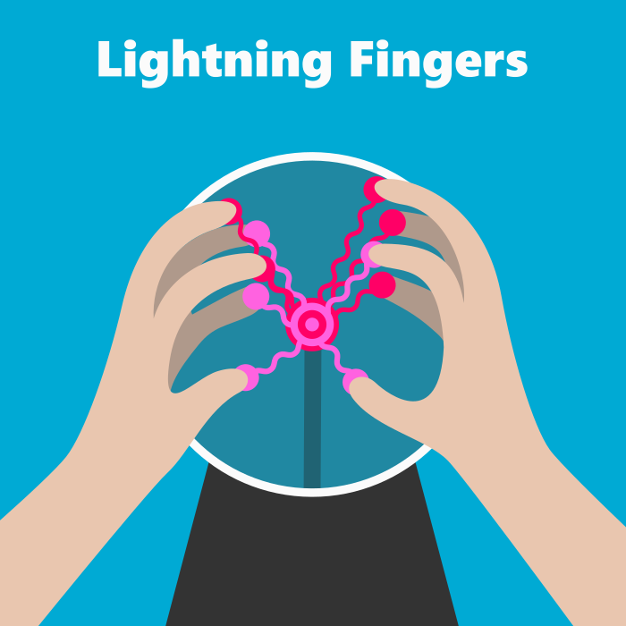

[Play now!](//jonashw.github.io/p5js_lightning_fingers) (touch device highly recommended)

## New versions (2026)

Both run on WebGL shaders (ISF) from the House Party toy kit, with no buttons or text on screen. Add `#knobs` to the address to get a control drawer.

- [`shader/`](shader/) is a faithful port of the original: same touch model, C13 chord, sparks, freeze and shake.
- [`plasma/`](plasma/) is a reimagined plasma globe. The bolts are simulated spring chains, fingers arc to each other, notes follow a chord progression, the globe charges up before each chord change, and tapping the core makes a jar that keeps the sparks. Add `#zaps` to turn the music off and keep only the electric sounds, or `#music` to keep the notes and drop the zaps. Add `#lamps` or `#lamps-both` to show the neon-lamp chord indicator.
